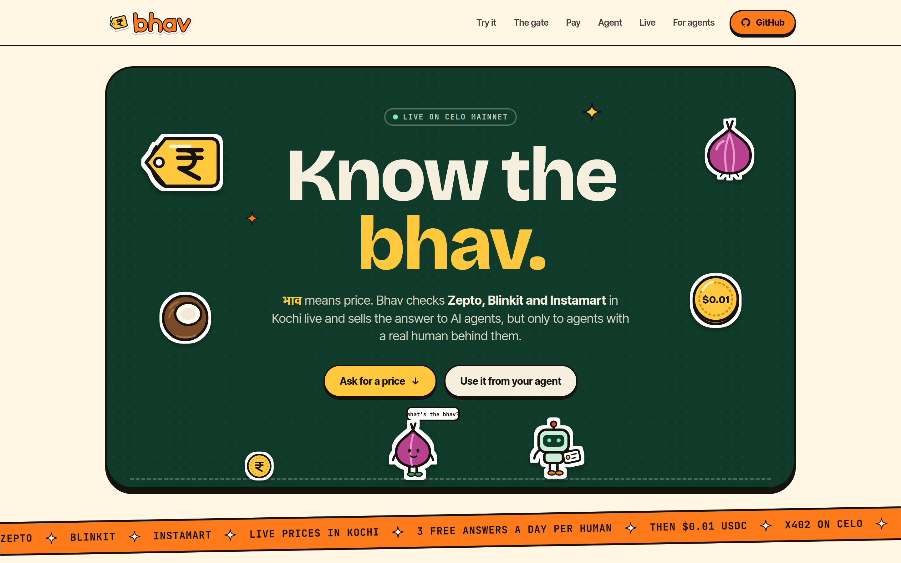
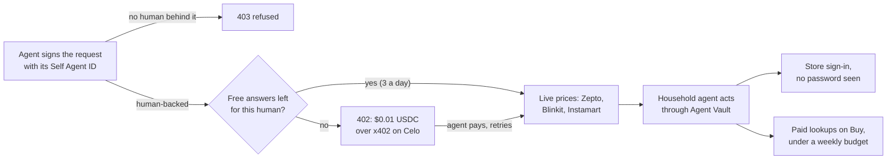
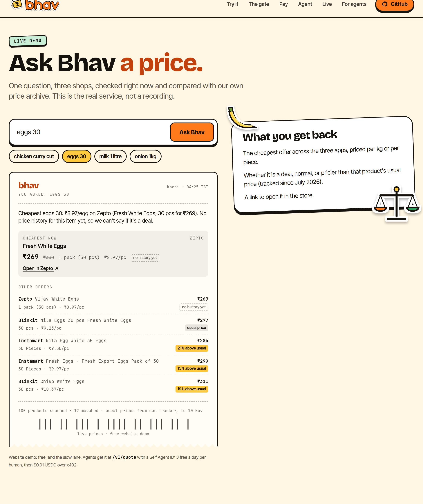
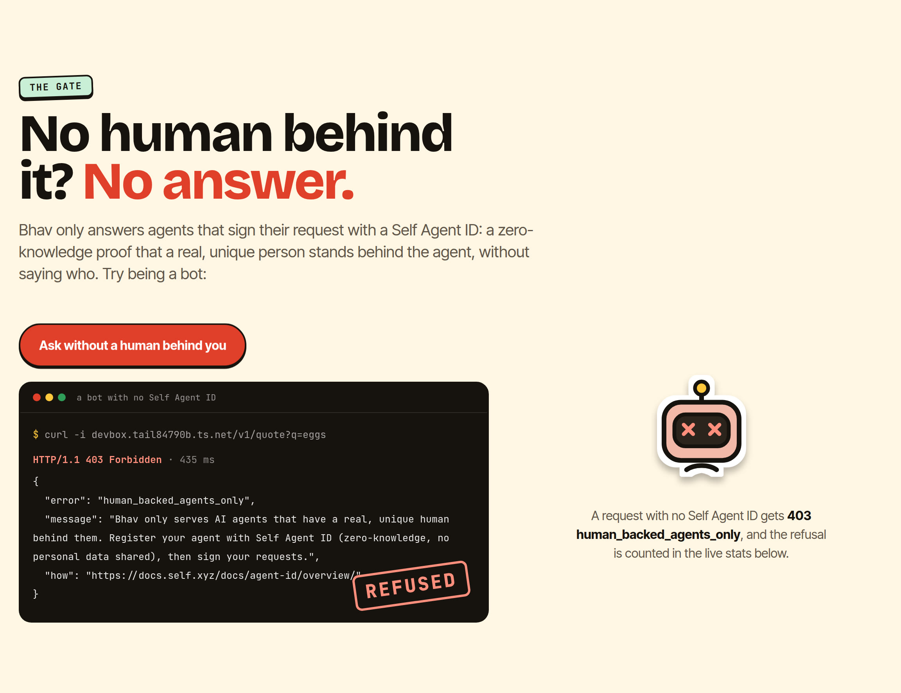
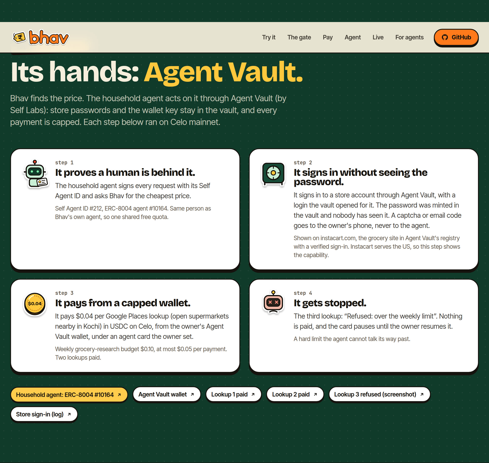

<div align="center">


# Bhav

**Know the bhav.**

Live grocery prices from Zepto, Blinkit and Instamart (Kochi), sold to AI agents per answer over x402 on Celo.<br />
Only agents with a real, unique human behind them get an answer. And the household agent acts through Agent Vault, with its secrets out of reach and a budget it cannot pass.

**[Open the site](https://bhav.exprmnts.fun)** · [Use it from your agent](docs/JOIN.md) · [One-minute check for judges](AGENTS.md) · [Live stats](https://devbox.tail84790b.ts.net/v1/stats)

[](https://github.com/nikhil-pn/bhav/actions/workflows/test.yml)
[](https://celoscan.io/address/0x33A80697Ac038279ca8d70F4c2Cef82672683b9F)
[](LICENSE)

</div>



<p align="center">
<a href="#bhav-in-30-seconds">In 30 seconds</a> ·
<a href="#how-it-works">How it works</a> ·
<a href="#try-it">Try it</a> ·
<a href="#celo-and-self-technology">Technology</a> ·
<a href="#how-it-fits-each-track">Tracks</a> ·
<a href="#security">Security</a>
</p>

## Bhav in 30 seconds

- **Bhav (भाव) means price.** Ask for "chicken curry cut" or "eggs 30" and Bhav checks Zepto, Blinkit and Instamart in Kochi right now, prices everything per kg or per piece, and says whether the cheapest is a deal against our own price archive.
- **No human behind it? No answer.** Every request must be signed with a [Self Agent ID](https://docs.self.xyz/docs/agent-id/overview/), a zero-knowledge proof that a real, unique person stands behind the agent. Bots get `403`.
- **Three free a day, per person. Then one cent.** The free quota belongs to the human, not the agent: ten agents from one person share it. After that, each answer costs $0.01 USDC, paid by the agent over [x402](https://x402.celo.org) on Celo mainnet. No account, no API key.
- **The household agent's hands: [Agent Vault](https://agentvault.io).** It signs in to a store without ever seeing the password, pays for services from a capped wallet, and is refused when it hits the weekly budget its owner set.
- **Built and checked in public.** 35 tests run the real Self verifier, x402 libraries and MCP client; a live check confirms every settlement on Celo; every claim below has a link.

Built during Celo's *Agents Open for Business* hackathon (from 21 Nov 2026). See [Hackathon notes](#hackathon-notes).

## Live on Celo mainnet

| What | Where |
|---|---|
| Website with a live demo and a live bot refusal | [bhav.exprmnts.fun](https://bhav.exprmnts.fun) |
| The API agents call | `https://devbox.tail84790b.ts.net/v1/quote?q=…` ([health](https://devbox.tail84790b.ts.net/health), [stats](https://devbox.tail84790b.ts.net/v1/stats)) |
| Bhav: ERC-8004 agent **#10088**, Self Agent ID **#211**, payTo `0x33A8…3b9F` | [registration](https://celoscan.io/tx/0xd041f1b77e5a7d1791dc0c3e4e6158cb3a4c44f2c4471d5e2c5d4c3c34d1bab4) · [Self proof](https://celoscan.io/tx/0x37226569553840e5e0afbbf2f62af16a2e6530c2b0eb79174beafde4ec51b71b) |
| Household agent: ERC-8004 agent **#10164**, Self Agent ID **#212** | [registration](https://celoscan.io/tx/0xea427047073fd4e17fd0a6dc36eb78de4dc989a723188415c4acca5609d01bc7) |
| Paid answers: 3 free, then $0.01 USDC over x402 | [CLI agent](https://celoscan.io/tx/0x6113bb79235a96b96b362d88002cb4eec62a2d1a59f68db9cb9d2ce7b37b7090) · [MCP agent](https://celoscan.io/tx/0x0c3b85edefffd6994bc3497e6bd8d402b71836e69db27a54eaf9a5c1e6ef699f) |
| Agent Vault wallet paying Buy (two store lookups) | [lookup 1](https://celoscan.io/tx/0xc2f9f9c9bcdd1986c130174e5220df4ac5ea8dec57f27288e4c7bd98624698bf) · [lookup 2](https://celoscan.io/tx/0x8fcb23fb4490a2046fe876f31be7270b0870b7140bac28e03d13fbaa9ccd1a54) |
| The third lookup refused by Agent Vault, over the weekly budget | [screenshot](docs/proof/agent-vault-weekly-budget-refusal.png) |
| Agent Vault sign-in to a store (instacart.com) | [log](docs/proof/instacart-signin-2026-11-28.log) · [owner's live view](docs/proof/instacart-signed-in-via-agent-vault-live-page.png) |

As of 28 November 2026, `/v1/stats` shows 7 agent answers (6 free, 1 paid), 5 refused bots, and 1 human so far (the builder; [outside users are joining](docs/JOIN.md)). The page reads the live numbers.

## How it works



1. **The gate.** Bhav verifies each request's Self Agent ID signature against the Self registry on Celo mainnet (`src/app.mjs`). It refuses a missing ID, an agent with no human proof, an expired proof, a proof from anyone but Self, and a replayed or re-targeted signature.
2. **The quota.** Free answers are counted per *human* (the Self nullifier), so one person cannot multiply them with more agents. The answer also says what the human chose to disclose: only whether they are an adult and their ID's country.
3. **The price.** Bhav opens each store's real search page in headless Chrome and reads the JSON the page itself loads, then compares prices per kg or per piece with our archive (collected July to November 2026).
4. **The payment.** Over the quota, Bhav answers `402` with x402 terms: $0.01 USDC on Celo mainnet. The agent signs an EIP-3009 authorization (no gas) and retries; Celo's facilitator settles it.
5. **The household agent.** It holds no password, card or wallet key. Agent Vault does: it types the store login into its own browser, pays Buy services from the owner's wallet, and stops the agent at the card's limits.



## Try it

### 1. On the website (no setup)
Open [bhav.exprmnts.fun](https://bhav.exprmnts.fun), ask for an item (free, rate-limited website lane), then press **Ask without a human behind you** to watch a bot get refused live.



### 2. As a bot (one command)
```bash
curl -si "https://devbox.tail84790b.ts.net/v1/quote?q=eggs" | head -1    # HTTP/2 403
```

### 3. With your own agent (10 minutes, a few cents)
Follow **[docs/JOIN.md](docs/JOIN.md)**: make an agent key, link it to your Self app (passport or Aadhaar), ask three free questions, fund it with $0.10 USDC on Celo from your own wallet, and watch the fourth answer get paid over x402.
```bash
git clone https://github.com/nikhil-pn/bhav && cd bhav && npm i
npm run agent:new && npm run agent:link     # then confirm in the Self app
npm run ask -- "chicken curry cut"
```

### 4. From Claude, Cursor or any MCP agent
Bhav ships an MCP server ([`src/mcp.mjs`](src/mcp.mjs)) and an agent skill ([`SKILL.md`](SKILL.md)). After steps 3's `agent:new` and `agent:link`:
```bash
claude mcp add bhav -- node "$PWD/src/mcp.mjs"
```
Then ask the assistant "where is milk cheapest in Kochi right now?": it calls `get_price`, signs with its Self Agent ID and pays the cent itself. Live run: Milma milk at ₹54/L on Instamart, paid over x402 from MCP ([tx](https://celoscan.io/tx/0x0c3b85edefffd6994bc3497e6bd8d402b71836e69db27a54eaf9a5c1e6ef699f)).

### 5. The household agent, end to end
```bash
node scripts/household.mjs "chicken curry cut"
```
1. **Self Agent ID:** it asks Bhav for the cheapest price as Self Agent ID #212 (free answers first, then x402).
2. **Agent Vault sign-in:** it signs in to instacart.com with a login Agent Vault opened for it; the password was minted in the vault and nobody has seen it. Instacart's reCAPTCHA goes to the owner's phone. Instacart serves the US, not Kochi: it is the one grocery site in Agent Vault's registry with a verified sign-in, so this step shows the capability. amazon.in was tried first and answers the proxy with its automated-access block page.
3. **Agent Vault wallet:** it pays $0.04 on [Buy](https://usebuy.ai) for a Google Places lookup of open supermarkets nearby (e.g. Finemart Supermarket, Kakkanad: open, 4.0).
4. **Agent Vault limit:** it looks up again; the third lookup would pass the $0.10 weekly budget, so Agent Vault refuses it (nothing paid) and pauses the card until the owner resumes it.



### 6. Run it locally
```bash
npm ci && npm test        # 35 tests, no network, no keys, no money
npm run test:live         # read-only check of the live mainnet API; confirms each settlement on Celo
npm start                 # the service starts without secrets: gate, free answers, stats and 402 terms work
```

## Celo and Self technology

| Technology | Where in the code | Notes |
|---|---|---|
| Self Agent ID: signed requests verified against the Celo registry | [`src/app.mjs#L52`](src/app.mjs#L52) `selfGate`, [`src/server.mjs#L24`](src/server.mjs#L24) | `SelfAgentVerifier` with replay protection; refusals logged and counted |
| Free quota per human (Self nullifier) | [`src/app.mjs#L94`](src/app.mjs#L94) `spendFree` | persisted, resets at midnight UTC |
| Self disclosures (adult, country only) | [`src/app.mjs#L83`](src/app.mjs#L83) `disclosed` | name, date of birth and ID number never read into a request |
| x402 on Celo mainnet (server) | [`src/app.mjs#L104`](src/app.mjs#L104) `paymentMiddleware` | `exact` scheme, USDC, Celo facilitator |
| x402 buyer with a spending cap | [`src/agent.mjs#L24`](src/agent.mjs#L24) `createBuyerFetch`, [`#L45`](src/agent.mjs#L45) `setSpendControls` | never more than $0.02 per answer, USDC on Celo only |
| Agent Vault wallet payments | [`src/vault.mjs#L38`](src/vault.mjs#L38) `pay`, [`src/household.mjs#L18`](src/household.mjs#L18) `nearbyStores` | `payRequest` from the owner's wallet under the agent card's limits |
| Agent Vault sign-in and owner handoff | [`src/vault-instacart.mjs#L31`](src/vault-instacart.mjs#L31), [`#L43`](src/vault-instacart.mjs#L43) | vault-opened login; captcha and email code handed to the owner |
| MCP server and agent skill | [`src/mcp.mjs`](src/mcp.mjs), [`SKILL.md`](SKILL.md) | tools `get_price`, `my_agent`; the key stays in a local file, never in the model |
| ERC-8004 identities | [`scripts/register-8004.mjs`](scripts/register-8004.mjs), [`agent.json`](agent.json), [`household-agent.json`](household-agent.json) | #10088 and #10164 on Celo mainnet |
| Attribution tag on every transaction we send | [`scripts/chain.mjs`](scripts/chain.mjs) `withAttribution` | tag `celo_bc5d483f879e` (Loops: tag seen, agent wallet on file) |

## How it fits each track

| Track | In one line |
|---|---|
| [Self Agent ID: Verified Agent Payments](#self-agent-id-verified-agent-payments) | Self Agent ID decides who is served, how much is free and who pays, with payments over x402 on Celo. |
| [Agent Vault: Online & Onchain Checkouts](#agent-vault-online--onchain-checkouts) | An agent that signs in without seeing a password and pays from a capped wallet that refuses it at the limit. |

### Self Agent ID: Verified Agent Payments
A know-your-agent gateway for a paid data API. Every request is signed; an agent with no human behind it is refused before any work is done; the free quota is per human, not per agent; and only then does x402 charge. This is what the host asked for on the kickoff stream ("an x402 API that only serves human-backed agents, with limits per person"), with real data behind it: live Indian grocery prices that no other agent service sells.

### Agent Vault: Online & Onchain Checkouts
Self's six requirements, and where each one is met:

| Requirement (Self livestream, 24 Nov) | Bhav |
|---|---|
| Sign in or check out on a regular website through Agent Vault | instacart.com sign-in ([log](docs/proof/instacart-signin-2026-11-28.log)) |
| At least one x402 payment on Celo | two Buy lookups from the Agent Vault wallet ([1](https://celoscan.io/tx/0xc2f9f9c9bcdd1986c130174e5220df4ac5ea8dec57f27288e4c7bd98624698bf), [2](https://celoscan.io/tx/0x8fcb23fb4490a2046fe876f31be7270b0870b7140bac28e03d13fbaa9ccd1a54)) |
| A spending limit, and the demo shows the agent hitting it | weekly budget refusal ([screenshot](docs/proof/agent-vault-weekly-budget-refusal.png)) |
| The agent never sees the card number or password | only `av_login_…` tokens and a wallet handle reach the agent |
| ERC-8004 identity | household agent #10164 |
| A public post with a demo clip and the repo | [docs/DEMO.md](docs/DEMO.md) (posted by the builder) |

## Security

### What a stolen server key can do
The Bhav server holds no key that can move money: x402 payments arrive at Bhav's wallet and are settled by Celo's facilitator. A stolen server could serve wrong prices or stop serving, and could read the log of agent addresses and Self nullifier prefixes; it holds no names, dates of birth or ID numbers.

### What a stolen household-agent key can do
Step 1's buyer key can sign x402 payments of at most $0.02 each, in USDC on Celo only (enforced in `src/agent.mjs`), from a wallet holding cents. Steps 2 to 4 hold no key: Agent Vault keeps the store password and the wallet key, and its agent card caps every payment ($0.05 each, $0.10 a week) and pauses at the limit.

### What the code guarantees
- No answer without a valid Self Agent ID signature; replayed or re-targeted signatures fail ([tests](test/service.test.mjs)).
- The free quota is per human, and a failed price lookup never uses one up.
- The buyer never pays more than its cap, in another asset, or on another network.
- The agent never fills a captcha or a code the site sent to the owner ([tests](test/instacart.test.mjs)).

### What you trust us for
- That the prices are what the stores showed (each answer links to the product page; prices are scraped live, not stored).
- That the service is up: it runs on one home server in India, because the store pages need a real browser and an Indian location.
- The website demo lane (`/v1/demo`) answers without a Self Agent ID, rate-limited to one request every 12 seconds for everyone, so people can try it.

## Repository

```text
src/app.mjs            the service: Self gate, quota per human, x402, demo lane, stats
src/server.mjs         wires the real Self verifier, Celo facilitator and live prices
src/agent.mjs          the buyer agent's client: signs with Self Agent ID, pays x402 under a cap
src/buyer.mjs          CLI for the buyer agent (npm run ask)
src/mcp.mjs            MCP server: get_price and my_agent for any MCP agent
src/prices/            live store search (Zepto, Blinkit, Instamart) and the price archive check
src/vault.mjs          Agent Vault wallet payments
src/household.mjs      the household agent's Buy lookups (open stores nearby)
src/vault-instacart.mjs, src/vault-signin.mjs, src/vault-monday.mjs   Agent Vault sign-ins
scripts/               household agent run, ERC-8004 + Self registration, new users, live check
test/                  35 tests (real libraries against signature-checking fakes)
web/                   the website (Next.js)
docs/                  join guide, demo script, requirements map, proof
```

**Docs:**
- [docs/JOIN.md](docs/JOIN.md): use Bhav with your own agent.
- [AGENTS.md](AGENTS.md): a one-minute check for judges and AI screeners.
- [SKILL.md](SKILL.md): the agent skill: when to call Bhav and how to read the answer.
- [docs/REQUIREMENTS.md](docs/REQUIREMENTS.md): every rule and track requirement, with proof.
- [docs/DEMO.md](docs/DEMO.md): the demo script.
- [AI_USAGE.md](AI_USAGE.md): how AI built this, how each part was checked, and where it was wrong.

## Hackathon notes

- **Built during the hackathon.** The repository's first commit is from 21 November 2026 and there is no earlier history. The price archive Bhav compares against is data collected by our own tracker from July 2026; all code here is new.
- **Tracks:** Self Agent ID (Verified Agent Payments), Agent Vault (Online & Onchain Checkouts).
- **Written with AI assistance:** the code, tests and docs were written by Claude Code (Anthropic) working with Nikhil P N, who chose what to build and did every human step (Self proof, approvals, captchas). Details in [AI_USAGE.md](AI_USAGE.md).
- **Libraries:** `@selfxyz/agent-sdk`, `@x402/express`, `@x402/fetch`, `@x402/evm`, `@agentvault/playwright`, `@celo/attribution-tags`, `@modelcontextprotocol/sdk`, `viem`, `express`, `playwright-core`; website: Next.js, React, Tailwind.
- **External services:** Self registry (Celo), Celo x402 facilitator, Agent Vault, Buy (usebuy.ai), Zepto, Blinkit and Instamart (public search pages).
- **License:** MIT. See [LICENSE](LICENSE).
